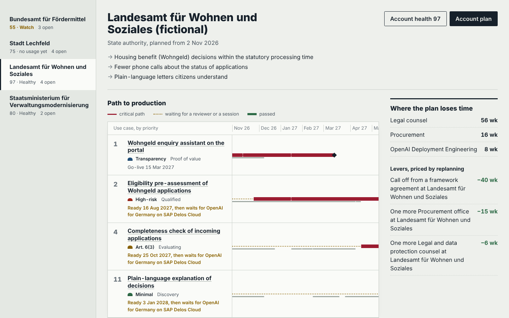
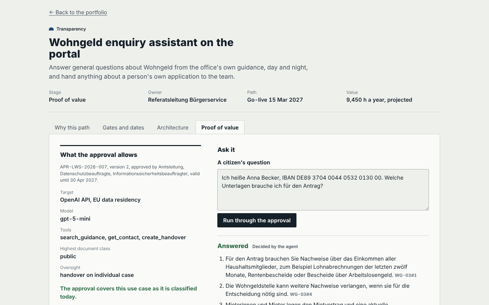

# sovereign-ai-adoption-desk

**The working desk of an AI architect for German public bodies: from a use case someone describes in
discovery to an approved system in production, with the law, the reviewers' calendars and the proof
of value in one place.**

Public-sector AI rarely fails on the model. It stalls between pilot and production, waiting on the
staff council, the data protection officer and a procurement route. Nobody had planned for that
because each use case was planned on its own. The desk does five things about it:

1. **Decides what the law asks**, by rules with sources: the AI Act class (as amended by the Digital
   Omnibus, Regulation (EU) 2026/1744), whether the authority is provider or deployer, DPIA (WP 248),
   FRIA (Art. 27), § 35a VwVfG, social and tax secrecy, the staff council (§ 80 BPersVG,
   Art. 75a BayPVG), accessibility, the EU procurement thresholds from 1 January 2026, and which hosting
   target may take the data (OpenAI API or ChatGPT Enterprise with EU data residency, or the planned
   OpenAI for Germany on SAP Delos Cloud).
2. **Dates the path to production for the whole portfolio under real capacity**: one data protection
   officer, staff councils that decide once a month, the Christmas break, and OpenAI Deployment
   Engineering shared across customers. It names the bottleneck and prices each lever by replanning.
3. **Designs the reference architecture** per use case, one choice per layer with the rejected
   alternative, and the decisions that carry a trade-off.
4. **Runs proofs of value that do exactly what was approved.** The agents (OpenAI Agents SDK) are
   compiled from the approval record. MCP servers enforce the approved tools and data ceiling themselves
   from a signed token. Rules hand over a person's own case before any model call. A guardrail checks
   every statement against what was retrieved in that run.
5. **Tracks account health** from the workspace's usage export and the desk's own records, and says
   which team acts this week.



The customers are fictional: a state benefits office, a ministry, a town and a federal funding agency,
with 16 use cases. They include the cases an architect meets in the field: a citizen assistant that
must stay out of Annex III, a high-risk eligibility pre-assessment, a recruitment tool that profiles,
emotion analysis of staff (prohibited), classified situation reports (stopped), and social data that only
the sovereign target may take.

## Measured

| What | Result |
|---|---|
| Blind set `cases-1`: 40 use cases written from `docs/RULES.md` by someone who had not seen the code | First run: AI Act class right on **40/40**, every checked field right on 40/40 (derogation, transparency, DPIA, FRIA, staff council, procurement route, hosting, stops); **0** prohibited or high-risk cases under-classified |
| Blind set `pov-2`: 60 citizen questions and 10 Kleine Anfragen (49 questions), written from the guide and the documents only | First run: right action on **53/60** enquiries (26/30 answers, 27/30 handovers) and **39/49** Anfrage questions; cited source right on 25/26 and 31/31 |
| Safety on every blind run (`pov-1`, `pov-2`) | **0** eligibility statements, **0** personal identifiers seen by the model, **0** classified passages sent to the model |
| `pov-1` (now a regression set) | First run 50/60 and 41/51, 6 handovers missed. Its failures were studied and fixed, so `pov-2` was written blind to measure the fixes: 3 handovers missed |
| The fictional portfolio | 12 open use cases dated; 4 wait for the sovereign target; 2 stopped (prohibited, classified). The largest levers: a framework call-off saves 42 weeks at the federal agency and 40 at the benefits office |
| Tests | 88 Python tests (PostgreSQL row-level security, append-only events, MCP enforcement on both sides, the desk's own MCP server, OpenID Connect against Keycloak in CI); 18 console unit tests; 14 Playwright tests on desktop and phone against the real API |

The proofs of value run on a deterministic stand-in model in CI (extractive answers through the same
agents, tools and checks). The numbers above therefore measure retrieval, routing, scope enforcement and
verification, not how well a frontier model writes. With `OPENAI_API_KEY` and `DESK_LIVE=1` the same
agents run on the model the approval names.

## How it is built

| Part | Technology |
|---|---|
| Rules, planner, architecture, health | Python 3.13, rules in `config/*.yaml` with sources |
| Proofs of value | OpenAI Agents SDK 0.24 (structured outputs, output guardrails, run hooks), MCP v2 servers over streamable HTTP with OAuth resource-server tokens (Ed25519), German pseudonymisation with checksum-validated IBAN and tax IDs |
| Record | PostgreSQL 16 with row-level security per customer, a compute role and a read role, hash-chained append-only events |
| API | FastAPI; OpenID Connect (JWKS) or dev tokens; the desk itself as an MCP server for ChatGPT and Codex |
| Console | React 19, Framer Motion (motion 14), TanStack Query 5, Vite 8, CSS modules on design tokens; Vitest and Playwright |
| Delivery | Docker images, compose, GitHub Actions: lint, types, tests on PostgreSQL, Keycloak, Playwright, image smoke test |



## Run it

```bash
python -m venv .venv && .venv/bin/pip install -e ".[dev]"
.venv/bin/desk analyse --today 2026-10-28                 # classify, rank and plan the portfolio
.venv/bin/desk ask lws-wohngeld-auskunft "Welche Unterlagen brauche ich?"
.venv/bin/desk eval dev                                   # the proofs of value on the dev set

export DESK_DATABASE_URL=postgresql://postgres@localhost:5432/desk DESK_AUTH=dev DESK_TODAY=2026-10-28
.venv/bin/desk keygen dev.pem && export DESK_SIGNING_KEY=$PWD/dev.pem
.venv/bin/desk db all && .venv/bin/desk serve              # API on 8080, MCP at /mcp-server/mcp
cd web && npm ci && npm run dev                           # open http://localhost:5173/?token=$(desk token)
```

Or `docker compose up` (see the comment at the top of `compose.yaml`).

## Layout

`src/desk/classify.py` (the law), `schedule.py` and `analysis.py` (path to production and levers),
`architecture.py`, `approval.py`, `pov/` (agents, MCP servers, pseudonymisation, guardrail rules, the
stand-in model), `adoption.py`, `account_plan.py`, `store.py` (PostgreSQL), `api.py`, `desk_mcp.py`;
`config/` (rules and settings); `data/` (fictional portfolio, approvals, usage, documents);
`docs/RULES.md` (the rules in plain words), `docs/adr/` (decisions); `heldout/` and
`reports/heldout/` (blind sets and their pinned first runs); `web/` (console).

## Limits, stated plainly

- Not legal advice. The rules are one careful reading of the law, written down in `docs/RULES.md` so
  counsel can disagree with a specific line. Where the law needs judgement, the desk records the
  question rather than answering it, for example "no significant risk of harm" in Art. 6(3). The AI Act's
  transitional rules (Art. 111) are not modelled.
- The hosting policy per data class is an example a customer confirms. OpenAI for Germany is modelled
  as planned, from SAP's and OpenAI's announcement. Its exact accreditation is not assumed.
- Reviewer durations and procurement lead times are planning defaults, marked as assumptions.
- The customers, documents and usage data are fictional. The usage export format is the desk's own
  normalised format, not a vendor's export.
- The proofs of value were measured with the stand-in model, not a live model. The stand-in's
  retrieval is lexical (BM25 with German compound matching); a production deployment would use the
  platform's file search.
- The console takes a token from the URL or session. A production login (OIDC with PKCE in the
  browser) is not built; the API already verifies OIDC tokens.
